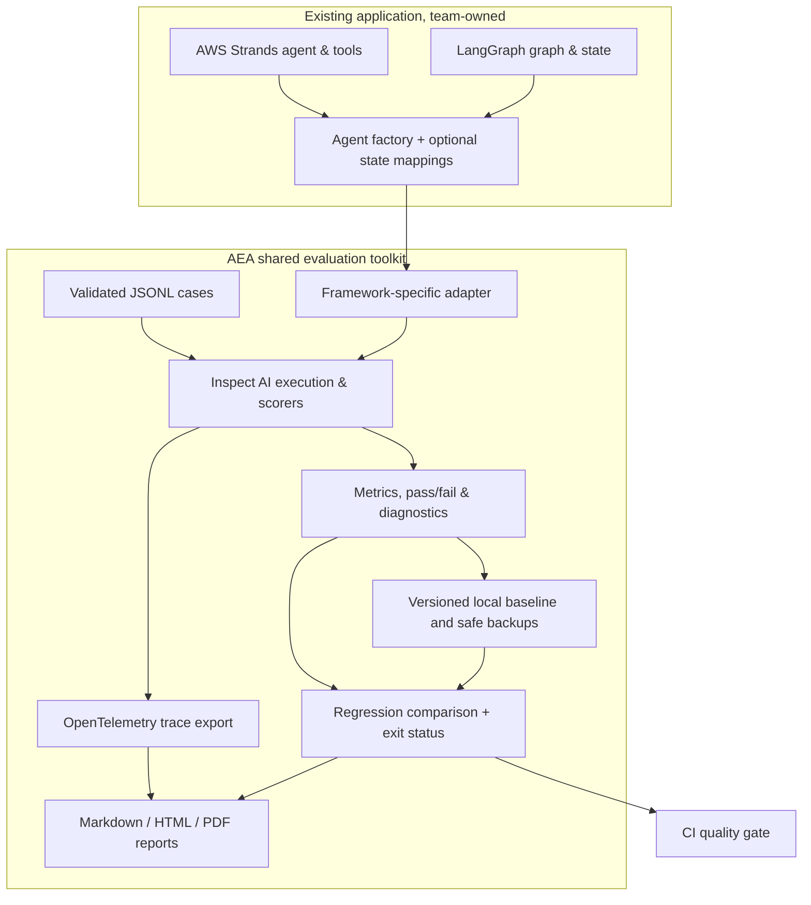

# Agent Engineering Accelerator
## Leadership showcase | Technical evidence, value proposition and adoption plan

**Version under assessment:** AEA 2.2.0, `dev`, 14 November 2026.  
**Decision requested:** Authorise a controlled, synthetic-data pilot with an independent engineer per framework. **Not** a production deployment or public-release decision.

### Executive view

**Problem:** Agentic AI teams need repeatable evaluation of answers, tool use, latency and regressions. The underlying Strands or LangGraph application should not need to be rewritten to gain consistent quality checks.

**Proposed reusable asset:** AEA is a Python CLI/library that sits **outside** the agent implementation, runs test cases through Inspect AI framework adapters, adds OpenTelemetry instrumentation, computes quality metrics and compares a run against a retained baseline.

**Current evidence:** Independent *application codebases*, authored for this technical evaluation, exercise both supported frameworks. Each has a 12-case synthetic suite. Both have a passing baseline, clean comparison and deliberately introduced regression detected with exit 1. [Six-job verification](https://github.com/AdityaSreevatsaK/agent-engineering-accelerator/actions/runs/43610474918) also covers Windows/Linux, Python 3.11/3.12, slow tests, offline examples, privacy checks and installed-wheel use.

**What this does not prove:** Improved developer productivity, genuine external team adoption, real cloud-provider performance, complete security assurance or confidential customer-data readiness. See [value assessment](VALUE_ASSESSMENT.md) and [security review](SECURITY_REVIEW.md).

### Architecture: reusable boundary

**Responsibilities:** Teams own agents, tools, business rules, data classification and provider credentials. AEA owns evaluation contracts, framework integration, regression comparison and local reporting. **Imported agent factories and scorers execute trusted Python code; AEA is not a sandbox.**

| Layer | Source | Why reusable |
| --- | --- | --- |
| Data contract | `dataset.py` | Same JSONL case structure across workflows |
| Runtime adaptors | `adapters/strands.py`, `adapters/langgraph.py` | Keep application frameworks independent from the evaluation engine |
| Evaluation | `run.py`, `scorers.py`, `judge.py`, `tool_metrics.py` | Answer/tool metrics and optional LLM judging |
| Observability | `tracing.py`, `trace_summary.py` | Consistent span collection and default minimisation |
| Regression gates | `compare.py`, `stats.py`, `baseline.py` | Explicit thresholds, detected new failures, retained approved snapshots |
| Evidence | `report.py`, `export.py`, CLI | Human-readable reports and CI-compatible exit codes |

For implementation detail and source-specific limitations, see [architecture](ARCHITECTURE.md), [usage](USAGE.md) and [security](SECURITY.md).

### The five-minute live narrative

Use the reproducible [speaker script and live commands](DEMO.md). The demo uses **11 synthetic Orders cases**, a passing agent, an intentional refund-policy defect, unchanged baseline SHA-256 fingerprints and a self-contained HTML report. The two **12-case** Strands/LangGraph integrations supply separate cross-framework evidence; do not combine these case counts as if they were one test.

| Time | What to show | Intended takeaway |
| --- | --- | --- |
| 0:00–0:45 | This page: problem and ownership boundary | Teams reuse evaluation instead of duplicating tooling |
| 0:45–1:30 | Existing agent factory, JSONL tests and `aea check` | The application keeps its own business logic |
| 1:30–2:30 | Passing baseline and unchanged comparison | Reproducible quality gate |
| 2:30–4:00 | Known refund-policy defect, exit 1, comparison HTML | An actionable regression is caught before promotion |
| 4:00–5:00 | Cross-framework CI, real benchmark, open approvals | Technical proof today, measured adoption later |

**Presenter discipline:** Run the commands beforehand in an approved local environment. The script does not overwrite an existing destination. Display only checked synthetic reports.

### Evidence-based outcomes

- **Confirmed:** Distinct Strands and LangGraph evaluations, 12/12 synthetic baseline cases each, one planted regression detected per application, stable approved baselines and CI-exercised distribution installation.
- **Measured locally in CI:** From [run 43609227896](https://github.com/AdityaSreevatsaK/agent-engineering-accelerator/actions/runs/43609227896), the two-repetition median unchanged-check times were **2.342 s** (Strands equipment support) and **2.613 s** (LangGraph supplier onboarding). These are different workloads and not comparative framework benchmarks.
- **Not yet evidenced:** A claimed percentage reduction in engineer hours, customer outcomes, two-team adoption, security sign-off or real provider costs. Never substitute synthetic timing for staff productivity.

### Why leadership should care

AEA could standardise quality evidence across teams using different orchestration frameworks, reduce duplicated evaluation infrastructure, and make regressions visible in CI. **Those are the value hypothesis**, not independently measured organisational benefits. The next decision is a controlled pilot, with up-front task definitions and time measurements against existing practice.

### Questions likely to arise

**Why not evaluate inside the agent application?** Shared dataset, scoring and regression interfaces make cross-application quality checks more consistent; teams can still use their own tests. This design avoids imposing one framework on all delivery teams.

**Is it cloud/provider agnostic?** Adapters support Strands and LangGraph. Agent owners configure compatible providers, but live AWS, OpenAI and other provider combinations have not been exhaustively validated.

**Does it cut developer effort?** Not measured yet. A fair comparison requires the same task, a real engineer, a credible manual/control workflow and recorded time to usable evidence.

**Is it safe for client data?** Not without approved access, redaction, retention, Windows ACLs and security review. Some identifiers can survive default payload redaction.

**What should be approved now?** A limited synthetic-data integration and measurement pilot, not promotion to `master` or general release.

### Next decision gates

1. Review the [dependency inventory and security assessment](DEPENDENCY_SECURITY_REVIEW.md), then seek authorised security/operations review.
2. Have independent Strands and LangGraph engineers follow the [pilot protocol](PILOT.md) and record results in the deliberately [blank evidence worksheet](PILOT_EVIDENCE_TEMPLATE.md).
3. Compare human setup effort and actual defects detected against the team's existing approach using the [measurement protocol](BENCHMARKING.md).
4. Confirm [release readiness](RELEASE_CANDIDATE_CHECKLIST.md) after evidence and approvals. Preserve `master` until explicit release approval.
